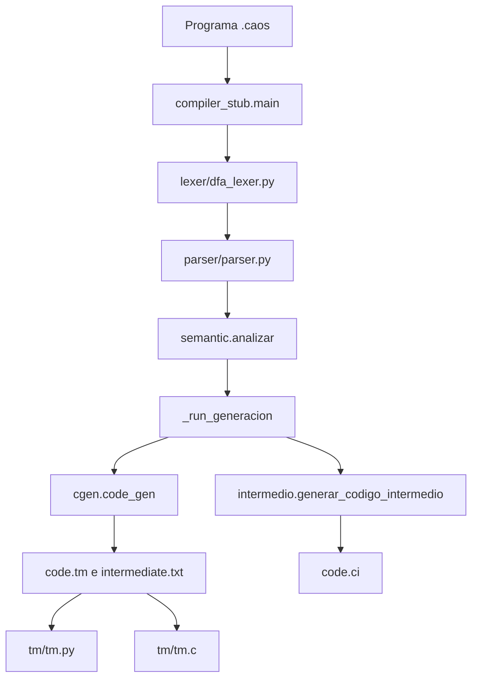

# Generación de código TM, tres direcciones y pruebas

Este documento describe cómo el compilador CAOS de la rama `B` (`30eac59`, «Implementa generación de código TM y CAOS») produce el archivo `.tm`, qué construcciones traduce, cómo ejecutarlo y qué se comprobó frente al cálculo a mano y frente al commit padre `45eac6a`.

La correspondencia instrucción por instrucción con el compilador TINY de Louden está en [`fase4-generacion-codigo.md`](fase4-generacion-codigo.md). Aquí se resume la arquitectura y se deja constancia de las pruebas.

## 1. Arquitectura

El punto de entrada es `external_compiler/compiler_stub.py`. `main` vacía todos los archivos de `OUTPUT_FILES` y después corre las fases pedidas, en orden:

`lexico` → `sintactico` → `semantico` → `intermedio` → `ejecutar`

La generación solo corre si `--phase` es `intermedio` o `ejecutar` (este último es el valor por defecto). `_run_generacion` vuelve a llamar a `semantic.analizar` sobre `ASTFormatter.to_binary(ast)`, el mismo análisis determinista de la fase 3, y a partir del árbol anotado y de la tabla de símbolos produce las dos salidas en paralelo:

| Salida | Función | Papel |
|---|---|---|
| `code.tm` | `codegen.code_gen` | Instrucciones TM. Entrada del simulador. |
| `code.ci` | `codegen.generar_codigo_intermedio` | Tres direcciones con temporales `t1`, `t2`, … y etiquetas `L1`, `L2`, …. No se traduce a TM y el simulador no lo lee. |
| `intermediate.txt` | el mismo texto que `code.tm` | El IDE histórico leía este nombre. Hoy la pestaña **Codigo Intermedio** muestra `code.tm`. |



### Archivos y funciones

| Archivo | Funciones | Qué hacen |
|---|---|---|
| `external_compiler/codegen/code.py` | `Emisor.emit_comment`, `emit_ro`, `emit_rm`, `emit_skip`, `emit_backup`, `emit_restore`, `emit_rm_abs` | Escriben cada instrucción en el momento. Los registros siguen la convención de TINY: `pc=7`, `mp=6`, `gp=5`, `ac=0`, `ac1=1`. El registro 2 se usa como auxiliar del módulo. |
| `external_compiler/codegen/cgen.py` | `code_gen`, `GeneradorTM.c_gen`, `gen_stmt`, `gen_exp`, `_gen_operador`, `_gen_logico` | Recorren el árbol anotado. `code_gen` emite el preludio (`LD`/`ST` de la dirección máxima), carga las cadenas de `cout` en memoria de datos, genera el programa y cierra con `HALT`. |
| `external_compiler/codegen/intermedio.py` | `generar_codigo_intermedio` | El mismo recorrido, en texto de tres direcciones. |
| `external_compiler/compiler_stub.py` | `_run_generacion`, `_run_ejecutar` | Escribe los tres archivos. `_run_ejecutar` solo deja en `exec.txt` la indicación de lanzar el simulador. |
| `tm/tm.py` | `TMSimulator.load`, `step`, `run` | Simulador que usa el IDE (F9) y la consola. |
| `tm/tm.c` | el mismo juego de instrucciones | Simulador de consola. Se compila con `gcc` o con `tm/compilar_tm.bat`. |
| `ide/core/compiler_runner.py` | `CompilerRunner.run` | Invoca el compilador con el directorio de trabajo `ide/outputs/` y lee `code.tm` en la clave `codigo_tm`. |
| `ide/ui/ide_window.py` | `_run_phase`, `_start_tm_execution` | Muestra el listado en la pestaña **Codigo Intermedio** y, con F9, lo carga en `TMSimulator`. |

`emit_skip` reserva un hueco y `emit_backup` / `emit_restore` lo completan más abajo en el archivo, con el número de dirección original. La TM carga por ese número, no por el orden físico de las líneas. Así se resuelven los saltos de `if`, `while` y el cortocircuito de `&&` / `||`.

Si el árbol no se puede traducir, `_run_generacion` agrega un error `[GENERACION]` y el proceso termina con código 4. `code.tm` y `code.ci` quedan vacíos.

### Dónde queda el archivo

El nombre es siempre `code.tm`. El compilador lo escribe en el directorio de trabajo, no junto al fuente.

| Quién compila | Directorio de `code.tm` |
|---|---|
| IDE (F5–F9) | `ide/outputs/code.tm` |
| Consola | `./code.tm` en el directorio desde el que se lanzó `compiler_stub.py` |

`.gitignore` ignora `code.tm`, `code.ci` e `ide/outputs/`. El archivo se crea al compilar; no forma parte del commit.

| Fase | Tecla | `--phase` | `code.tm` |
|---|---|---|---|
| Léxico | F5 | `lexico` | Vacío. El arranque lo trunca y esta fase no lo vuelve a escribir. |
| Sintáctico | F6 | `sintactico` | Vacío. |
| Semántico | F7 | `semantico` | Vacío, aunque una compilación anterior hubiera dejado código. |
| Generación | F8 | `intermedio` | Listado del fuente actual, si el análisis no tuvo errores. |
| Ejecutar | F9 | `ejecutar`, o sin `--phase` | El mismo listado. En consola hay que lanzar el simulador aparte. En el IDE, F9 lo ejecuta. |
| Consola TM | Shift+F9 | recompila hasta `intermedio` | Abre el `code.tm` recién escrito en `tm` / `tm.exe`. |

F8 y F9 guardan el editor antes de compilar y el compilador borra las salidas al empezar. Al abrir otro archivo y volver a generar, el comentario `File:` del listado y el texto de la pestaña cambian al fuente nuevo. Comprobado con `borde_cache_a.caos` y `borde_cache_b.caos` en `pruebas/codegen/correr_casos_borde.py`.

## 2. Construcciones que el compilador traduce

El lenguaje que llega al generador es el que ya aceptan el parser y el semántico (sin cambios desde `45eac6a`).

### Expresiones, precedencia y asociatividad

| Operadores | Asociatividad | Ejemplo verificado |
|---|---|---|
| `^` | Derecha. Ata más que `*` y `/`. | `2 ^ 3 ^ 2` = 512. `2 * 3 ^ 2` = 18. `(2 * 3) ^ 2` = 36. |
| `*`, `/`, `%` | Izquierda. | `2 ^ 10 % 100` = 24. `17 % 5` = 2. `17 / 5` = 3. |
| `+`, `-` | Izquierda. | `2 + 3 * 4` = 14. `(2 + 3) * 4` = 20. `20 - 4 - 3` = 13. `8 / 2 + 15 * 4` = 64. |
| `<`, `<=`, `>`, `>=`, `==`, `!=` | Un relacional entre dos expresiones simples. El resultado es bool y se imprime como 0 o 1. | Los diez casos de `borde_04`. `3.0 == 3` es verdadero. |
| `&&`, `||` | La misma precedencia. Asocian a la **derecha**. | `false && false \|\| true` es `false && (false \|\| true)` = 0. `true \|\| false && false` es `true \|\| (false && false)` = 1. Con paréntesis, `(true \|\| false) && false` = 0. |
| `!` | Unario prefijo. | `!(true)` = 0, `!(false)` = 1. |

Esa asociación de `&&` y `||` sale del parser: en `external_compiler/parser/parser.py`, el operando derecho de un `&&` o `||` vuelve a analizarse con `_expresion()`, así que el operador de la derecha queda más adentro del árbol. El generador no reordena la expresión: emite el árbol que recibió. El comportamiento es el de la fase 3, anterior a este generador.

La división entera trunca hacia cero (`7 / 2` = 3). Si algún operando es float, la operación es real (`7 / 2.0` = 3.5; `7 / 2` asignado a un float sigue siendo la división entera 3 y luego se ensancha a 3.0). El residuo `%` solo admite enteros y toma el signo del dividendo, igual que la división: `-17 % 5` = -2 y `17 % -5` = 2. Una potencia con resultado entero se trunca. Los paréntesis cambian el árbol, como en `borde_19` y `borde_20`.

`&&` y `||` hacen cortocircuito. Si el operando izquierdo ya decide, un salto se brinca el derecho. Con `a = 0`, `a != 0 && 1 / a > 0` imprime 0 y termina en `HALT`. Con `a == 0 || 1 / a == 1` el izquierdo es verdadero, el derecho no se ejecuta y el resultado es 1. Si el izquierdo no evita la división (`a == 0 && 1 / a == 1`), la TM se detiene con `Division by 0` y no llega al `cout`.

### Tipos, lectura y escritura

Tipos de variable: `int`, `float` y `bool`. `real` es alias de `float`. La conversión implícita permitida es de int a float. Un float no se asigna a un int.

| Construcción | Código TM |
|---|---|
| Literal entero, real o bool | `LDC`. `true` es 1 y `false` es 0. |
| Identificador | `LD` con el desplazamiento de la tabla de símbolos respecto de `gp`. |
| Asignación | La expresión queda en `ac` y se guarda con `ST`. |
| `id++` / `id--` | `LD`, `LDC 1`, `ADD` o `SUB`, `ST`. Son sentencias, no expresiones. |
| `cin` de int o bool | `IN`. Un bool distinto de cero se normaliza a 1. |
| `cin` de float | `INF`. |
| `cout` de int o bool | `OUT` (el bool se ve como 0 o 1). |
| `cout` de float | `OUTF` (hasta 6 decimales, sin ceros de más, mínimo `x.0`). |
| `cout` de cadena | `OUTS` sobre los bytes UTF-8 guardados en memoria de datos. `\n` y `\t` se interpretan. |
| Fin de cada `cout` | `OUTLN`. |
| `<<` dentro de `cout` | Separador de elementos, no un operador del lenguaje. Varios elementos del mismo `cout` salen en la misma línea. |

No hay menos unario. `w = -1;` es un error sintáctico en el `-`. Los negativos entran por `cin` (`IN` e `INF` aceptan signo).

### Condiciones y ciclos

| Construcción | Formas que acepta el parser | Traducción |
|---|---|---|
| `if` / `else` / `end` | El `else` es opcional. Los paréntesis de la condición también. | Si la condición es 0, salta al `else` o al final. El `else` salta al fin del `if`. |
| `while` | `while condicion { cuerpo }` o `while condicion cuerpo end`. | Salta al final si la condición es 0 y, tras el cuerpo, regresa a la prueba. |
| `do` / `until` | `do cuerpo until condicion`. El cuerpo puede contener otros ciclos. | El cuerpo se ejecuta y, si la condición es falsa, regresa al inicio. |

No hay `for`.

Casos de borde comprobados en el simulador:

- `while` cuya condición es falsa desde el principio: el cuerpo no corre (`borde_09`, `borde_10`).
- `while` anidado y condición compuesta `k < 5 && k != 3` (`borde_09`).
- `do`/`until` que termina tras la primera pasada (`until (a > 0)` y `until (true)`), tres vueltas, y un `while` dentro del `do` (`borde_11`, `borde_12`).
- `if`/`else` anidado, rama entonces y rama else, e `if` sin `else` que no entra (`borde_08`, `borde_17`).

## 3. Cómo usar el simulador

El simulador recibe el `code.tm`, no el fuente ni el `code.ci`.

Consola, Python (los mismos comandos que `tm.c`: `g` ejecuta, `s` da un paso, `q` sale):

```
python external_compiler/compiler_stub.py pruebas/codegen/00_factorial.caos --phase intermedio
python tm/tm.py code.tm
```

Consola, C:

```
gcc -std=c11 -O2 tm/tm.c -o tm/tm -lm
./tm/tm code.tm
```

En el IDE, F9 recompila y llama a `TMSimulator`. Cada `IN` pide un entero y cada `INF` un real. La pestaña **Ejecucion** muestra la entrada, la salida y el estado final (`HALT`, división entre 0, fallo de memoria o límite de pasos). Shift+F9 abre el simulador de C en otra consola.

`tm.py` y `tm.c` comparten el juego de instrucciones de Louden más las extensiones de CAOS: registros y datos en real, `INF`, `OUTF`, `OUTLN`, `DIVF`, `POW` y `OUTS`. `DIV` sigue siendo la división entera que trunca hacia cero.

## 4. Plan de pruebas

1. **Casos de borde de este documento.** `python pruebas/codegen/correr_casos_borde.py` compila cada `pruebas/codegen/borde_*.caos` en un directorio temporal, exige un `code.tm` con `HALT`, lo ejecuta en `tm.py` y, si hay `gcc`, en `tm.c`, y compara la salida con el valor calculado a mano. También comprueba que, al compilar dos fuentes seguidos, el `code.tm` queda con el nombre del segundo, y que `--phase semantico` lo deja vacío.
2. **Programas de la fase 4.** `cd external_compiler && python -m unittest test_codegen` corre `pruebas/codegen/00_factorial.caos` … `08_division_cero.caos` (factorial, promedio, signo, descuento, Fibonacci, votos, operadores, Ulam y división entre cero).
3. **Ejercicios finales.** `python codigo_caos/probar_ejercicios.py` compila los 60 programas de `codigo_caos/grupo_*/` y ejecuta los 154 casos de `codigo_caos/casos.py` en los dos simuladores.
4. **Regresión de las fases anteriores.** `python -m unittest test_semantico test_integracion test_parser test_parser_recovery` en `external_compiler`, y `python -m unittest test_semantic_output` en `ide`.
5. **Ubicación del archivo.** Consola desde un directorio temporal, con y sin `--phase intermedio`, y `CompilerRunner` con un `outputs_dir` propio, que es la clase que usa el IDE. El IDE gráfico no se abrió en el entorno de la revisión porque ahí no hay Tkinter; la ruta que llena y muestra el `.tm` es la de `CompilerRunner`.

Los valores esperados de la tabla siguiente se calcularon a partir del fuente y de las reglas de la sección 2, antes de mirar la salida del simulador. En los ejercicios de `codigo_caos/`, el esperado es el de `casos.py`, también calculado a mano.

## 5. Esperado y obtenido

Revisión hecha sobre `30eac59`. `tm.py` y `tm.c` produjeron el mismo texto de programa. El estado `HALT` del simulador de C aparece como `HALT: 0,0,0` / `Halted`; la división entre cero, como `Division by 0`.

| Programa | Esperado | Obtenido |
|---|---|---|
| `borde_01` precedencia y paréntesis | 14, 20, 64, 76, 13, 18, 36 | Igual. HALT |
| `borde_02` potencia derecha y módulo | 512, 2, 3, 24 | Igual. HALT |
| `borde_03` int, float y bool | 3, 3.0, 3.5, 1, 0, 1 | Igual. HALT |
| `borde_04` relacionales, incluido `3.0 == 3` | 0 1 0 1 1 0 1 1 1 1 | Igual. HALT |
| `borde_05` `&&`, `||` a la derecha, y `!` | 0, 1, 0, 0, 1, 1 | Igual. HALT |
| `borde_06` cortocircuito que evita la división | 0, 1, 1 | Igual. HALT |
| `borde_07` cortocircuito que no la evita | sin salida | Division by 0 |
| `borde_08` if/else anidado y if que no entra | 2, 0, 4 | Igual. HALT |
| `borde_09` while que no entra, anidado y compuesto | 5, 6, 3 | Igual. HALT |
| `borde_10` while compuesto que no entra | 0 | Igual. HALT |
| `borde_11` do-until y while anidado | 4, 3, 4 | Igual. HALT |
| `borde_12` `until (true)`, una sola pasada | 11 | Igual. HALT |
| `borde_13` cin/cout int, float, bool, `\t`, `\n`, `<<`. Entradas 4, 5, 1.5, 2 | 9, 1.5, 1, `hola` y tab y `mundo`, `linea1` / `linea2`, `4 y 1.5` | Igual. HALT |
| `borde_14` cin -17 y 5 | -2, -3 | Igual. HALT |
| `borde_15` cin 17 y -5 | 2, -3 | Igual. HALT |
| `borde_16` `++`, `--` y `real` | 11, 11.5 | Igual. HALT |
| `borde_17` if sin else y `while ... end` | 4, 6 | Igual. HALT |
| `borde_18` cin bool 0, 1 y -4 | 0, 1, 1 | Igual. HALT |
| `borde_19` paréntesis en la condición | 20 | Igual. HALT |
| `borde_20` expresión mixta | 19, 19.5 | Igual. HALT |
| `00`–`08` de `test_codegen` (factorial, promedio, signo, descuento, Fibonacci, votos, operadores, Ulam, división entre cero) | los valores del propio test | 13 casos correctos en `tm.py` y `tm.c` |
| 60 ejercicios de `codigo_caos/` | los 154 casos de `casos.py` | 154/154 correctos en `tm.py` y `tm.c` |

De los 81 `.caos` del repositorio en el momento de la revisión, 74 generaron un `code.tm` con `HALT`. Los 7 restantes fallan antes de la generación, con `code.tm` vacío: error léxico en `ide/samples/Otro.caos` y `TestIDE.caos`, error sintáctico en `ide/samples/nuevo.caos`, `ide/samples/test_errores.caos`, `pruebas/codigo_errores.caos` y `pruebas/conerrores.caos`, y error semántico en `pruebas/corecccc.caos`.

## 6. Regresión frente a `45eac6a`

`45eac6a` es el padre de `30eac59`. Entre esos dos commits no hay diferencias en `external_compiler/lexer/`, `external_compiler/parser/` ni `external_compiler/semantic/`. La generación solo consume el árbol anotado y la tabla.

En `30eac59` pasaron, sin cambiar esas fases:

- `test_semantico`, `test_integracion`, `test_parser`, `test_parser_recovery` y `test_codegen`: 80 pruebas.
- `ide/test_semantic_output`: 5 pruebas.
- Los 154 casos de `codigo_caos/probar_ejercicios.py`.

Este documento y `pruebas/codegen/correr_casos_borde.py` no modifican el compilador. El script vuelve a exigir las mismas salidas de la tabla.

## 7. Limitaciones conocidas

- El archivo se llama `code.tm` y aparece en el directorio de trabajo. Buscarlo junto al `.caos`, o con el nombre del programa, no lo encuentra.
- F5, F6, F7 y `--phase lexico|sintactico|semantico` lo dejan vacío. Un análisis correcto hasta semántica no es una generación de código.
- `code.ci` no se ejecuta. `exec.txt`, en consola, es un aviso de cómo lanzar el simulador, no la salida del programa.
- No hay `for` ni menos unario.
- `&&` y `||` comparten precedencia y asocian a la derecha. No siguen la precedencia de C, en la que `&&` ata más que `||`.
- Las cadenas solo pueden aparecer en `cout`.
- Los valores de la TM son reales de doble precisión. Los enteros son exactos hasta 2^53.
- El simulador del IDE se detiene a los 5 000 000 de pasos para cortar un ciclo infinito.
- Una división entre cero en tiempo de ejecución detiene la TM. El cortocircuito solo la evita cuando el operando izquierdo ya decidió el resultado.
